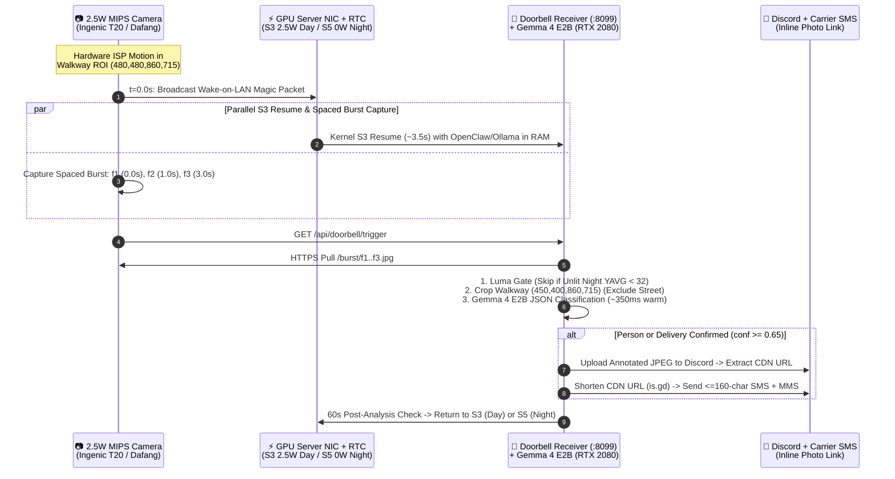

# ⚡ Zero-Idle AI Doorbell Sentry (v2): 2.5W Edge Wake-on-LAN Tripwire & Day/Night S3/S5 GPU Orchestrator

[](https://www.python.org/)
[](https://ollama.ai)
[](#)
[](#)
[](LICENSE)

> **Evolution of [🎃 Trick-or-Treat Sentry (v1)](https://github.com/Benfinkels/trick-or-treat-sentry-):**  
> In **v1**, our GPU homelab server stayed awake (`~140W`) polling the porch camera on Halloween night to classify trick-or-treater costumes with local `Gemma 4`.  
> In **v2 (`zero-idle-ai-sentry`)**, we inverted the architecture for 365-day production: the **GPU server stays asleep or powered off (`2.5W` S3 RAM sleep during the day, `0W` S5 full shutdown at night)** while a liberated **2.5W Ingenic T20 MIPS Linux camera (`Dafang-Hacks`)** acts as an always-on hardware tripwire that wakes the GPU server via **Wake-on-LAN** only when motion occurs on the front walkway.

---

## 🏗️ End-to-End Architecture



---

## 🔋 Hybrid Day/Night Power Schedule & Green FinOps

| Time Window (Local) | Idle Target State | Server Power Draw | Wake Latency | Wake Mechanism & Transition |
| :--- | :--- | :--- | :--- | :--- |
| **Daytime (`07:00 – 23:00`)** | **ACPI S3 Suspend-to-RAM** | **`~2.5 W`** (Camera `2.5W` + RAM `2.5W`) | **`~3.5 sec`** | Wakes via camera **Wake-on-LAN** (`GLAN`); arms hardware RTC wake alarm (`/sys/class/rtc/rtc0/wakealarm`) for `23:00` night shutdown. |
| **Nighttime (`23:00 – 07:00`)** | **ACPI S5 Full Power-Off** | **`0.0 W`** (Camera `2.5W` only) | **`~27.0 sec`** | Full OS power-off after night idle threshold; arms hardware RTC wake alarm for `07:00` morning standby. |
| **Post-Doorbell Wake** | **Fast Re-Sleep (`60s`)** | Returns to **S3** or **S5** | Immediate | If woken by a false-positive motion event with no human session active, re-suspends **60 seconds** after analysis completes. |

---

## 🛠️ Real-World Hardware & Kernel Engineering Post-Mortems

Building a zero-idle physical security system exposed five subtle hardware/OS failure modes that are solved in this repository:

### 1. The Delivery Van "Cooldown Blindfold" Trap -> Spaced Parallel Burst
* **The Bug:** With a naive `180s` cooldown on the camera's motion hook, an arriving delivery van on the street (`t = 0s`) triggers motion while the courier is still inside the cab (`person = false` on the walkway) and **blindfolds the camera for the next 3 minutes** while the courier walks up the steps and drops off the package.
* **The Fix ([`firmware_hooks/doorbell-wake.sh`](firmware_hooks/doorbell-wake.sh)):**
  * Lowered the camera's script debounce to `12s` (moving the notification cooldown to the server *after* `person == true`).
  * Broadcasts Wake-on-LAN at `t = 0.0s` and spaces the 3-frame burst across **`t = 0.0s, 1.0s, 3.0s`** while the server takes `~3.5s` to resume from S3 RAM sleep — capturing the courier mid-walkway on `f2.jpg`/`f3.jpg` with **zero added wall-clock latency**.

### 2. Street Passerby False Positives -> Dual Hardware + Crop ROI
* **The Bug:** Wide-angle porch cameras see public sidewalks/streets in the upper third of the frame (`y < 400`), causing pedestrians and cyclists on the street to trigger alerts.
* **The Fix ([`sentry/doorbell_service.py`](sentry/doorbell_service.py)):**
  * Configures the Ingenic T20 hardware ISP `region_of_interest=480,480,860,715` (and restarts `v4l2rtspserver-master` so the ISP reloads coordinates).
  * Crops each `1280x720` frame to `CLASSIFY_CROP_BOX = (450, 400, 860, 715)` before sending to `gemma4:e2b-it-q4_K_M`, physically excluding the street (`y < 400`) from the vision model's field of view.

### 3. Carrier MMS Gateway Drops -> Discord CDN + Shortened SMS Bridge
* **The Bug:** Carrier email-to-MMS gateways (such as Verizon `@vzwpix.com`) frequently drop or delay external image attachments by 10–30 minutes, whereas plain-text email-to-SMS (`@vtext.com`) delivers in `~2 seconds`.
* **The Fix ([`sentry/doorbell_service.py`](sentry/doorbell_service.py)):**
  * Uploads the annotated JPEG to Discord first, extracts the public `https://cdn.discordapp.com/attachments/...` URL from the API response, shortens it to an 18-character `https://is.gd/...` URL, and embeds `Photo: https://is.gd/...` directly inside the `<=160`-character `@vtext.com` SMS body so iOS/Android Messages renders an instant inline photo preview.

### 4. Duplicate-Named ACPI `PXSX` 1-Second Spurious Wake Storms
* **The Bug:** After entering S3 sleep, the server woke up 1 second later with kernel `xhci_hcd ... xHC error in resume, USBSTS 0x401, Reinit` errors. In Linux `/proc/acpi/wakeup`, multiple PCIe devices share the 4-character ACPI name `PXSX`, so echoing `PXSX > /proc/acpi/wakeup` only toggles the *first* `PXSX` entry and leaves secondary controllers (like an ASMedia USB 3.1 controller at `pci:0000:05:00.0`) `*enabled`.
* **The Fix ([`power_orchestrator/node-sleep.sh`](power_orchestrator/node-sleep.sh)):**
  * First iterates over every `*enabled` PCI device in `/proc/acpi/wakeup` (except `GLAN` Ethernet) and writes `disabled` directly to `/sys/bus/pci/devices/<bdf>/power/wakeup`, then toggles any remaining non-`GLAN` ACPI symbols. Verified that **only `GLAN`** remains enabled in `/proc/acpi/wakeup`.

### 5. Overdue Systemd Timer Immediate Re-Sleep Race
* **The Bug:** When a server sleeps in S3 for `>15 minutes`, a `5-minute` systemd idle timer (`OnUnitActiveSec=5m`) becomes overdue and fires within `1 second` of kernel resume — seeing `idle > 15m` and immediately putting the server back to sleep before the doorbell classification completes.
* **The Fix ([`power_orchestrator/node-resume.sh`](power_orchestrator/node-resume.sh)):**
  * Records `last_resume_ts` on `post/suspend` and enforces a `180s` post-resume grace window on periodic timer checks while allowing `--doorbell-post-check` to re-suspend after its dedicated `60s` window.

---

## 📂 Repository Structure

* **[`firmware_hooks/doorbell-wake.sh`](firmware_hooks/doorbell-wake.sh):** Dafang-Hacks (`Ingenic T20 MIPS`) motion hook with `12s` burst debounce, parallel WoL broadcast, and `0s / 1s / 3s` 3-frame burst capture.
* **[`sentry/doorbell_service.py`](sentry/doorbell_service.py):** HTTP burst receiver (`:8099`), luminance gate (`YAVG`), walkway ROI cropper, `Gemma 4 E2B` (`keep_alive="15m"`, `think=False`) JSON classifier, Discord + `is.gd` SMS photo dispatcher, and 60s fast re-sleep scheduler.
* **[`sentry/orchestrator.py`](sentry/orchestrator.py):** 5-Tier Ephemeral Compute router and Green FinOps kWh/cost calculator.
* **[`power_orchestrator/node-sleep.sh`](power_orchestrator/node-sleep.sh) & [`node-resume.sh`](power_orchestrator/node-resume.sh):** S3 suspend helper with sysfs PCIe/USB wake disarmer, hardware RTC wake alarm readback verification, and systemd sleep hook.
* **[`tests/test_sentry.py`](tests/test_sentry.py):** Unit test suite (`pytest` and `python -m unittest` compatible) covering FinOps math, ROI street exclusion, luma gating, Gemma 4 JSON fence stripping, and 160-char SMS formatting.

---

## 🧪 Quickstart & Testing

```bash
git clone https://github.com/Benfinkels/zero-idle-ai-sentry.git
cd zero-idle-ai-sentry
pip install -r requirements.txt
cp .env.example .env

# Run the unit test suite (works with both unittest and pytest)
python -m unittest tests/test_sentry.py -v
```
